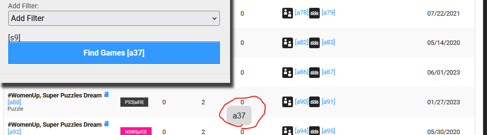
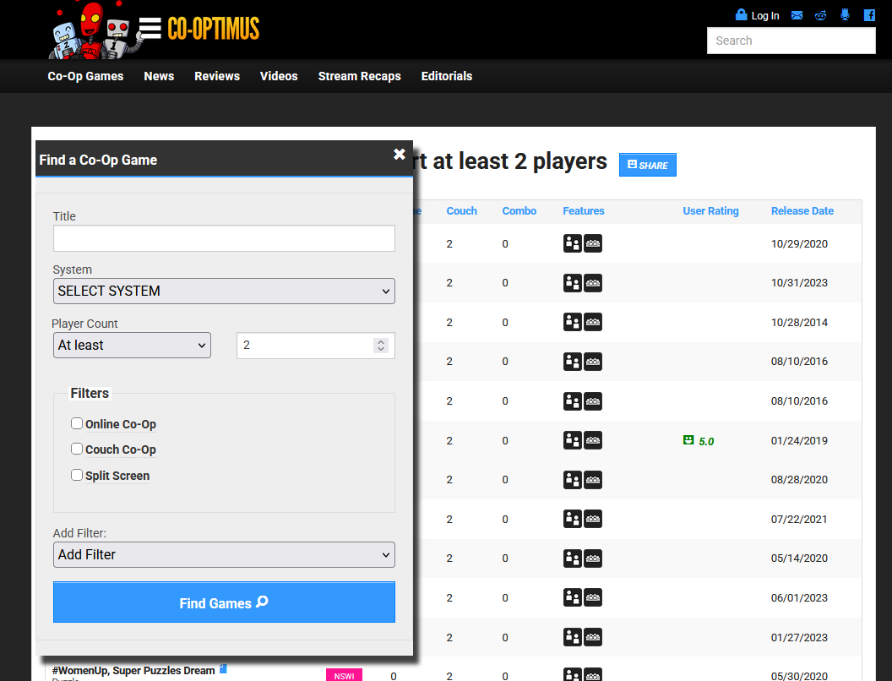
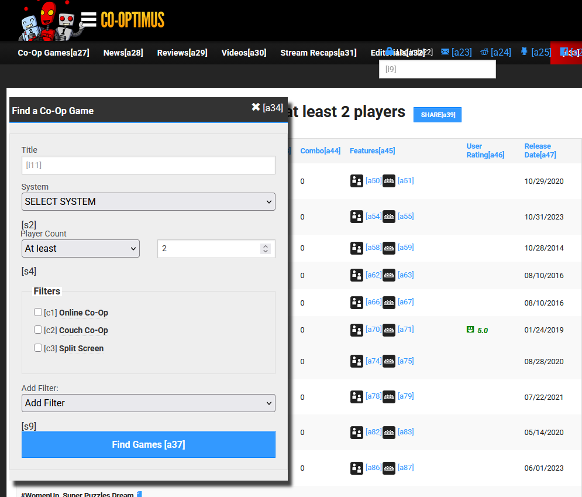

This extension allows to use keyboard shortcuts to interact with lots of html elements.

Original:

With addon appear visible shortcuts for input, a, select, checkbox and button:

Floating text with input pressed limited and backspace allowed:

In progress add configuration options with an extension's interface.
